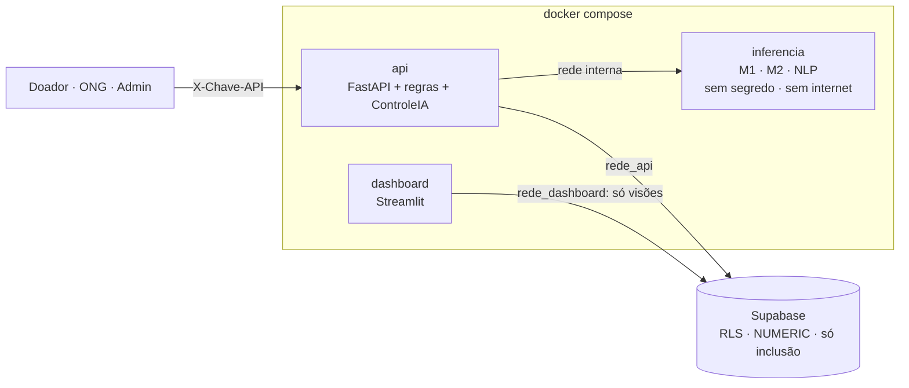

# Rede Alimenta IA

Plataforma com **IA e DevSecOps** que conecta, em tempo real, doadores de alimentos a ONGs na Grande São Paulo. Ela prioriza lotes, prevê descarte e aproveita **frete de retorno** para reduzir o desperdício e combater a fome.

> Projeto Integrador FIAP · Tecnólogo em Inteligência Artificial · Prof. M.Sc. Oerton Fernandes · 2026

| | Link |
|---|---|
| **API pública (Swagger)** | `https://<usuario-hf>-rede-alimenta-api.hf.space/docs` |
| **Dashboard público** | `https://<usuario-hf>-rede-alimenta-dashboard.hf.space` |
| **Pipeline CI/CD** | aba *Actions* deste repositório (testes → Bandit → Trivy → security gate → deploy) |

---

## O problema

A comida sobra onde há comércio e a fome está na periferia. No recorte do projeto, **85% dos doadores comerciais** ficam em setores de vulnerabilidade baixíssima ou muito baixa, e **77% das ONGs** em setores de vulnerabilidade alta ou muito alta (IPVS 2022, SEADE). Além da distância, a comida pronta fora da geladeira dura só **3 horas**.

## Como a plataforma resolve

1. **Cadastro seguro:** o doador descreve o lote em texto livre. Um modelo de embeddings (Hugging Face) sugere categoria e armazenamento, o doador confirma e o **sistema calcula a validade**, sem confiar no valor digitado. **Tudo que entra é validado** (esquema estrito, dígito verificador de CPF/CNPJ, guardrail, regra), e o tipo do doador vem da **conta autenticada**, nunca do corpo da requisição.
2. **Questionário + Declaração de Doação:** as respostas viram um documento **assinado (RSA-PSS) e imutável**, gravado no banco numa tabela **só de inclusão** (Lei 14.016/2020).
3. **Modelo 1: prioridade** (CRÍTICA, ALTA, MÉDIA, BAIXA), com **piso de segurança**: o modelo nunca rebaixa um caso crítico.
4. **Matching** com filtros obrigatórios (o que a ONG aceita, cozinha, refrigeração, freezer, **disponibilidade mútua** doador × ONG, **impasse "só entrega × só busca" bloqueado**, com o hub como ponto de encontro) e score por **tempo até receber**, capacidade, **vulnerabilidade do setor** (30% do peso) e pedidos abertos das ONGs.
5. **Transporte em cascata:** ONG ou voluntário, doador, motorista de retorno, transportadora com rota A→B vazia e, só em último caso, entregador de app pago por um **caixa solidário** (sem lucro, `Decimal`/`NUMERIC`, tetos e aprovação externa).
6. **Modelo 2: risco de descarte**, que decide quando vale gastar o caixa para não perder a comida.
7. **IA isolada e controlada:** a inferência roda num **container próprio, sem segredos e sem internet**. Quem decide é a `ControleIA` na API, com interruptor por modelo, fallback para a regra e log de toda chamada.
8. **DevSecOps:** Docker endurecido, GitHub Actions com **Bandit + Trivy + security gate**, log auditável com cadeia HMAC, observabilidade por linha de base estatística, banco com **RLS e menor privilégio**.

**Diferenciais** em relação a plataformas existentes (ex.: Comida Invisível): IA de prioridade e descarte, frete de retorno, ranking por vulnerabilidade social e validade calculada pelo sistema.

## Resultados (ano simulado set/2025–ago/2026, regras v2.1)

| Indicador | Valor |
|---|---|
| Lotes simulados | 24.135, 6,9% bloqueados no cadastro (validade ou questionário) |
| **Alimento salvo / refeições** | **352 t / ~951 mil refeições** |
| Taxa de descarte (meta < 20%) | **17,8%** |
| Tempo mediano até o match (benchmark de mercado ~8 min) | **26,4 min** (CRÍTICA é ofertada primeiro) |
| Modelo 1 (teste temporal) | acurácia **92,0%** · recall CRÍTICA **94,3%** (meta ≥ 90%) |
| Modelo 2 (teste temporal) | recall **87,1%** (meta ≥ 85%) · ROC-AUC 0,87 · PR-AUC **0,65** (heurística sem IA: 0,28) |
| NLP de texto livre | 80,3% de acurácia em 6,6 ms/texto (zero-shot NLI: 49,7% em 5,7 s); ponto fraco: "não perecível" (52%) |
| **Vulnerabilidades (SAST + imagens)** | **22 → 0**: Bandit 6 → 0 (1 alta) e Trivy 16 → 0 (3 altas); security gate aprovado |
| Matriz STRIDE | 34 ameaças · residual sem riscos altos ou críticos |
| Observabilidade | 4 de 5 anomalias injetadas detectadas; alarmes falsos < 0,02% em dados normais |
| Ciclo de feedback (RLHF adaptado) | atacante em quarentena (0 rótulos aceitos); o portão barrou um candidato que subia a média (80% → 89%) mas derrubava a classe crítica "preparado" (92% → 80%) |
| Testes automatizados | 221 (216 locais + 5 contra PostgreSQL real no CI) |

---

## Arquitetura



```
src/
├── api/              FastAPI: rotas, autenticação/papéis, matching de lote novo, repositório, ponte com a IA
├── inferencia/       serviço de inferência isolado (só executa os modelos)
├── dashboard/        Streamlit: impacto social, qualidade da IA, segurança, ao vivo
├── regras/           regras de negócio puras (validade, prioridade, matching, questionário, caixa, refeições)
├── validacao/        esquemas de entrada estritos, dígito verificador CPF/CNPJ, verificação na Receita
├── seguranca/        guardrail, minimização, segredos, Declaração assinada + PDF, STRIDE, resumo SAST
├── observabilidade/  registro auditável (cadeia HMAC), anomalias por linha de base, freio, drift (PSI)
├── models/           features, treino, NLP, artefatos com hash, controle da IA, feedback humano
├── governanca/       catálogo de dados (classe, base legal, retenção, dono) e qualidade de dados
├── db/               carga do ano simulado no banco
└── data/             curadoria IPVS, premissas, entidades, simulação, gerador
db/schema.sql         esquema relacional (NUMERIC, UUID, RLS, papéis, tabelas só de inclusão, visões)
Dockerfile            alvos: api · inferencia · dashboard · completo
docker-compose.yml    ambiente local endurecido (+ PostgreSQL local no perfil banco-local)
.github/workflows/    pipeline DevSecOps
deploy/               publicação nos Hugging Face Spaces
reports/sast/         relatórios Bandit/Trivy e resumo do gate
```

## Como rodar

### Docker (recomendado)

```bash
cp .env.exemplo .env          # preencha os segredos (instruções no arquivo)
docker compose up --build     # API em :8000/docs · dashboard em :8501
```

Para ter um banco local em vez do Supabase: `docker compose --profile banco-local up --build` e `python -m src.db.carregar`.

### Python

```bash
python -m venv .venv
.venv\Scripts\activate   # Windows (Linux/macOS: source .venv/bin/activate)
pip install torch==2.14.0 --index-url https://download.pytorch.org/whl/cpu
pip install -r requirements-dev.txt

python -m src.models.treinar               # treina e avalia os Modelos 1 e 2 (~30 s)
uvicorn src.api.app:app --reload           # API em http://localhost:8000/docs
streamlit run src/dashboard/app.py         # dashboard em http://localhost:8501
pytest                                     # testes
```

Em desenvolvimento, a API aceita chaves `dev:<papel>:<id>` (ex.: `dev:doador:D-0008`, `dev:ong:O-023`, `dev:admin:A-01`). Em produção, só as chaves cadastradas por hash (`python -m src.api.chaves`).

<details><summary>Regenerar dados, relatórios e demonstrações</summary>

```bash
python -m src.data.curadoria_ipvs           # baixa o IPVS 2022 (83 MB) e valida o SHA-256
python -m src.data.gerar_dataset            # gera o dataset (semente 42, ~3 min)
python -m src.models.avaliar_nlp            # avalia NLP + guardrail (baixa o modelo HF, ~490 MB)
python -m src.seguranca.stride              # Matriz STRIDE (xlsx + tabela)
python -m src.governanca.qualidade          # 15 checagens de qualidade de dados
python -m src.observabilidade.demo          # observabilidade com anomalias injetadas
python -m src.models.demo_feedback          # ciclo de feedback com envenenamento simulado
python -m src.seguranca.exemplo_declaracao  # declaração assinada de exemplo + PDF
bandit -r src -f json -o reports/sast/bandit.json && python -m src.seguranca.relatorio_sast --gate
```
</details>

## Pipeline DevSecOps

| Etapa | O que faz | Barra o merge/deploy se |
|---|---|---|
| Testes | pytest (regras, API, segurança, IA) + **PostgreSQL 16 real** (esquema, RLS, só inclusão, carga do ano simulado) + qualidade de dados | qualquer teste falhar |
| SAST | **Bandit** no código | (vai para o gate) |
| Imagens | build das 3 imagens + **Trivy** (CVEs nas imagens, dependências e configuração do Dockerfile/Compose) | (vai para o gate) |
| Security gate | `src/seguranca/relatorio_sast.py --gate` | houver achado **ALTO/CRÍTICO** aberto |
| Deploy | publica API e dashboard nos Hugging Face Spaces | o gate reprovar ou não for a `main` |

Dependabot abre PRs semanais de atualização (pip, Docker, Actions), que passam pelo mesmo gate.

## Deploy (Hugging Face Spaces + Supabase)

1. **Supabase:** crie o projeto e rode `python -m src.db.carregar` com `REDE_ALIMENTA_DB_ADMIN_URL` (conexão do dono, só na sua máquina). No SQL Editor, defina as senhas dos papéis: `ALTER ROLE rede_api WITH LOGIN PASSWORD '...'` e `ALTER ROLE rede_dashboard WITH LOGIN PASSWORD '...'`.
2. **GitHub:** em *Settings → Secrets and variables → Actions*, crie o secret `HF_TOKEN` (token de escrita do Hugging Face) e a variável `HF_USUARIO`. Crie o environment `producao`.
3. **Spaces:** depois do primeiro deploy, configure as *Secrets* de cada Space: API → `REDE_ALIMENTA_AMBIENTE=producao`, chaves HMAC, `REDE_ALIMENTA_CHAVE_DECLARACAO_PEM`, `REDE_ALIMENTA_CHAVES_API`, `REDE_ALIMENTA_DATABASE_URL` (papel `rede_api`); dashboard → `REDE_ALIMENTA_DASHBOARD_DB_URL` (papel `rede_dashboard`) e `REDE_ALIMENTA_API_PUBLICA`.

## Documentação

- [Regras de negócio v2.1](docs/regras-de-negocio.md): fonte de verdade de todo o sistema
- [PRD](docs/prd.md) (requisitos de produto) · [SDD](docs/sdd.md) (arquitetura, GRC, decisões D1–D12)
- [Esquema do banco](db/schema.sql) · [Dicionário de dados](docs/dicionario-de-dados.md)
- Governança: [política de IA e dados](docs/governanca/politica-governanca-ia.md) · [análise de agência da IA](docs/governanca/analise-agencia-ia.md) · [matriz de controles](docs/governanca/matriz-controles.md) · [inventário de dados (LGPD)](docs/governanca/inventario-de-dados.md) · [RIPD](docs/governanca/ripd.md)
- [Matriz STRIDE](docs/stride/matriz-stride.md) · [planilha](docs/stride/matriz-stride.xlsx)
- [Revisão contra o checklist do professor](docs/revisao-checklist-professor.md)
- [Exemplo de Declaração de Doação (PDF)](docs/exemplos/declaracao-exemplo.pdf)
- [Notebook de análise e resultados](notebooks/01_eda_e_resultados.ipynb)

## Fontes de dados

| Fonte | Uso |
|---|---|
| IPVS 2022, Fundação SEADE | Vulnerabilidade por setor censitário, posição das entidades |
| TACO 4ª ed., NEPA/UNICAMP | kcal por categoria (conversão kg → refeições) |
| PAT, Portaria Interministerial nº 66/2006 | 700 kcal por refeição principal |
| WRAP / FareShare | 420 g por refeição (preparados) |
| Lei 14.016/2020 | Base legal da doação de excedentes |

## Roadmap

- [x] **CP1: MVP de IA** · dataset estruturado · modelos locais · Matriz STRIDE
- [x] **CP2: DevSecOps** · Dockerfile + Compose · GitHub Actions · Bandit + Trivy · security gate
- [x] **CP3: Deploy e impacto** · API FastAPI · dashboard Streamlit · Supabase · Hugging Face Spaces · LGPD · pitch
