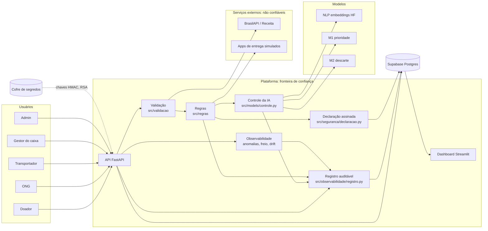
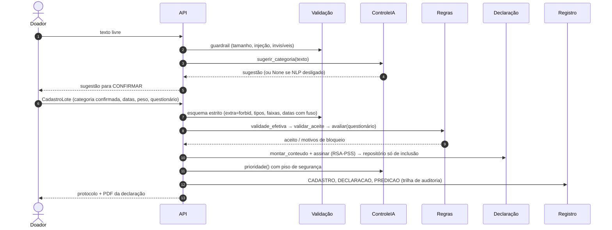
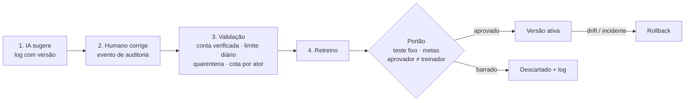
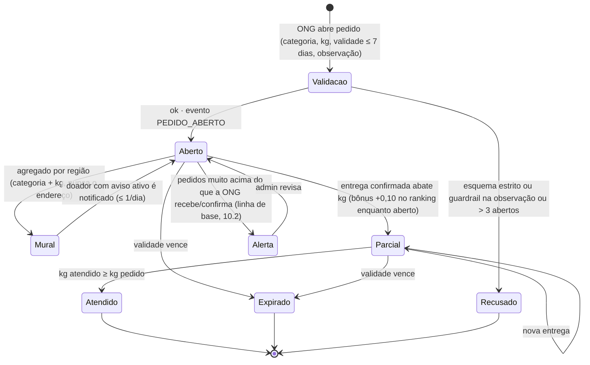
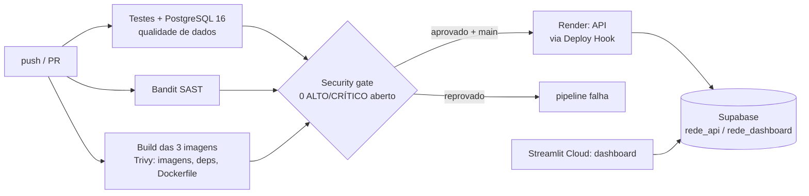

# SDD: Rede Alimenta IA

> **Software Design Document** · v2.1 · 2026-10-14
> O **como**. Requisitos em [PRD](prd.md); regras em [regras-de-negocio.md](regras-de-negocio.md); ameaças em [STRIDE](stride/matriz-stride.md).

---

## 1. Princípios de arquitetura

| Princípio | Decisão concreta |
|---|---|
| A IA recomenda, a regra decide | Toda chamada de modelo passa por `ControleIA`, que só devolve `Recomendacao`. Nenhum modelo grava, paga ou aciona transporte |
| Autorização fora do modelo | Tetos, validade mínima, filtros de ONG e permissões estão em `src/regras/`, código puro e testado |
| Entrada não confiável | Validação em 5 camadas antes de qualquer dado ser considerado (regras 4.6) |
| Uma fonte de verdade por regra | Simulação, API e testes importam as **mesmas** funções de `src/regras/` |
| Falha fechada | Serviço externo indisponível → pendente de revisão, nunca aprovado por omissão |
| Evidência por padrão | Todo controle tem teste; toda decisão tem registro auditável |

## 2. Visão geral

## 3. Módulos do código

| Pacote | Responsabilidade | Depende de |
|---|---|---|
| `src/regras/` | Regras de negócio puras: validade, prioridade, logística, questionário, cadastro, refeições | nada (só stdlib) |
| `src/validacao/` | Esquemas de entrada (Pydantic estrito), dígito verificador, verificação na Receita | `regras` |
| `src/seguranca/` | Guardrail de texto, minimização/pseudônimo, segredos, Declaração (RSA-PSS) + PDF, STRIDE | `regras` |
| `src/observabilidade/` | Registro auditável (2 trilhas, cadeia HMAC), anomalias (linha de base), freio, drift (PSI) | `seguranca` |
| `src/models/` | Features (controle de vazamento), treino, NLP, artefatos com hash, **controle da IA**, **feedback** | `regras`, `observabilidade` |
| `src/governanca/` | Catálogo de dados (classe, base legal, retenção, dono), qualidade de dados | `validacao` |
| `src/data/` | Curadoria IPVS, premissas, entidades, simulação do processo, gerador | `regras` |
| `src/api/` | **API FastAPI** (v2.1): rotas, autenticação por chave e papel, matching de lote novo, repositório (Supabase ou memória), ponte com a inferência | todos acima |
| `src/inferencia/` | **Serviço de inferência isolado** (v2.1): só executa M1, M2 e NLP; sem segredo, sem escrita, sem decisão | `models` |
| `src/dashboard/` | **Dashboard Streamlit** (v2.1): lê só visões agregadas | `seguranca.stride` |
| `src/db/` + `db/schema.sql` | Esquema relacional (NUMERIC, RLS, só inclusão) e carga do ano simulado | — |

> As regras não dependem de nada. É por isso que a mesma função que decide na API também gera o dataset e é testada isoladamente.

## 4. Fluxos principais

### 4.1 Cadastro de lote

### 4.2 Matching e transporte

1. **Filtros obrigatórios** (`motivo_incompatibilidade`, capacidade, raio, **disponibilidade mútua**, rota expressa e, na v2.1, o **impasse busca × entrega** via `modo_logistico`). O motivo de exclusão de cada ONG vai para o log (`exclusoes_matching` no evento `CADASTRO_LOTE`).
1b. **Par redundante** (`aplicar_regra_redundante`): proibido se houver alternativa; sem alternativa, exceção com evento `EXCECAO_REDUNDANTE`.
2. **Score** (`score_ong`): acesso, capacidade, vulnerabilidade, turno; complementaridade e pedido multiplicados pelo acesso.
3. Oferta sequencial com prazo por prioridade; após 3 falhas, escala ao admin.
4. Transporte em cascata: gratuitos primeiro. O pago só entra com espera estourada **e** M2 (via `ControleIA.risco_descarte`) indicando risco alto.
5. Caixa: até o teto a ONG confirma; acima dele, o gestor externo aprova.

### 4.3 Ciclo de feedback (RLHF adaptado)

### 4.4 Ciclo de vida do pedido da ONG (regras 6.5)

### 4.5 Declaração de Doação no banco (regras 4.5)

1. A API monta o JSON canônico, assina com RSA-PSS 3072 (chave só na API, em segredo do ambiente) e grava em `rede.declaracoes`.
2. `rede.declaracoes` é **só de inclusão** em duas camadas: o papel `rede_api` não tem `UPDATE`/`DELETE`/`TRUNCATE` (`REVOKE`), e um **gatilho** recusa essas operações até para o dono da tabela. Uma correção vira **nova versão**, encadeada pelo `sha256_versao_anterior`.
3. **Remoção:** o hash de cada declaração também vai para o registro auditável (cadeia HMAC). Apagar uma declaração direto no banco, com privilégio de superusuário, quebra a conferência entre as duas trilhas.
4. Qualquer pessoa verifica com a chave pública: `GET /v1/lotes/{codigo}/declaracao` devolve `assinatura_valida`.

## 5. Dados

| Entidade | Chave | Observação |
|---|---|---|
| Doador | `doador_id` | Documento só como HMAC; PF no centroide do setor |
| ONG | `ong_id` | Capacidades, janela, categorias aceitas, status de aprovação |
| Lote | `lote_id` | Cadastro, validade calculada, questionário, prioridade, desfecho |
| Declaração | `declaracao_id` + versão | JSON canônico assinado; versões encadeadas por hash |
| Pedido | `pedido_id` | Categoria, kg, validade, kg atendido |
| Evento | `evento_id` | Trilha do processo de cada lote |
| Registro auditável | `evento_id` + `hash` | Cadeia HMAC; 90 dias / 5 anos |

Classificação, base legal, retenção e dono de **cada coluna**: `src/governanca/catalogo.py` (verificado por teste).

**Esquema relacional:** [`db/schema.sql`](../db/schema.sql) (v2.1, checklist item 14):
- **`NUMERIC` em toda quantidade, contagem, medida e valor**, dinheiro em `NUMERIC(10,2)`. Não há `INTEGER` nem `FLOAT`: `tests/test_schema.py` falha o pipeline se aparecer. Chave técnica `UUID` + código legível `TEXT UNIQUE`.
- **RLS em todas as tabelas** + papéis próprios: `rede_api` (insere lotes/eventos/declarações; atualiza só o desfecho de lotes de origem `api`) e `rede_dashboard` (só `SELECT` nas visões `vw_*`, sem identificador de pessoa).
- `CHECK` das regras no próprio banco: `aceita_coleta OR pode_entregar`, freezer ⇒ refrigeração, validade do pedido ≤ 7 dias, versão 1 ⇔ sem hash anterior.
- No CI, um PostgreSQL 16 descartável aplica o esquema, carrega o ano simulado inteiro (24.135 lotes passam por todas as `CHECK`) e testa o "só inclusão" e os papéis.

## 6. GRC: Governança, Risco e Compliance

| Pilar | Como o projeto atende | Onde |
|---|---|---|
| **Governança** | Política de IA e dados, papéis (RACI), regras versionadas como fonte de verdade, portão de promoção com segregação de funções (quem treina não aprova), interruptor por modelo | [política](governanca/politica-governanca-ia.md), [regras](regras-de-negocio.md), `src/models/controle.py`, `feedback.py` |
| **Risco** | STRIDE com 34 ameaças pontuadas P×I (1–5), risco inerente e residual, riscos de IA (viés, drift, confiança excessiva), análise de agência (5C), observabilidade com freio | [STRIDE](stride/matriz-stride.md), [agência](governanca/analise-agencia-ia.md), `src/observabilidade/` |
| **Compliance** | LGPD (ROPA do art. 37, RIPD, minimização, HMAC, retenção), Lei 14.016/2020 (doação de excedentes), CDC art. 27 (5 anos de auditoria), controles mapeados para ISO 27001/42001, NIST CSF/AI RMF e OWASP | [inventário](governanca/inventario-de-dados.md), [RIPD](governanca/ripd.md), [matriz de controles](governanca/matriz-controles.md) |
| **Evidência contínua** | O pipeline transforma controle em prova: testes, qualidade de dados, Bandit, Trivy e security gate a cada push; catálogo de dados verificado por teste | `.github/workflows/ci.yml`, `reports/sast/resumo.json` |

## 6.1 Segurança por camada (aula 6: seis camadas)

| Camada | Controles implementados |
|---|---|
| Governança | Regras versionadas; política de IA; RACI; registro de riscos; portão de promoção com segregação |
| Dados | Minimização, HMAC, catálogo verificado por teste, qualidade de dados, retenção |
| Modelo | Artefato com SHA-256, modelos HF fixados por commit e só em safetensors, piso de segurança, drift |
| Aplicação | Validação em 5 camadas, guardrail, declaração assinada, log à prova de adulteração |
| Ferramentas/agentes | IA sem agência (só recomenda); integrações externas tratadas como não confiáveis, com falha fechada |
| Infraestrutura | Imagens slim por responsabilidade, usuário sem privilégio, `read_only`, `cap_drop: ALL`, `no-new-privileges`, **inferência em rede interna sem saída e sem segredos**; Bandit + Trivy + gate; segredos fora do repositório; RLS e papéis no Supabase |

## 7. Decisões de projeto (resumo)

| # | Decisão | Alternativa descartada | Motivo |
|---|---|---|---|
| D1 | Validade **calculada** pelo sistema | Validade digitada | Entrada não confiável (STRIDE T1) |
| D2 | NLP por **similaridade de embeddings** | Zero-shot NLI | 80% vs. 50% de acurácia, 6,6 ms vs. 5,7 s por texto (dataset v2.1) |
| D3 | Cadeia de log com **HMAC** | SHA-256 puro | Quem escreve no arquivo sem a chave não recalcula a cadeia |
| D4 | Declaração assinada com **RSA-PSS** | Só hash | Hash prova integridade, mas não a origem; assinatura prova as duas |
| D5 | Linha de base com **mediana/MAD** | Média/desvio-padrão | Robusta às próprias anomalias |
| D6 | Complementaridade **× acesso** | Peso aditivo | Aditivo custava 1 p.p. de descarte (calibração) |
| D7 | RLHF adaptado a **feedback validado + portão** | RLHF clássico (PPO) | Não há LLM; o risco central é o envenenamento do feedback |
| D8 | Esquema com **extra=forbid + strict** | Validação permissiva | Impede campo injetado (`"aprovado": true`) e conversão silenciosa |
| D9 | Impasse "só entrega × só busca" **bloqueado** (hub como única saída); redundante **proibido** com alternativa | Preferência no score (v2.0) | Checklist do professor. A v2.0 tratava como preferência porque o modelo de dados não separava capacidade de restrição; a v2.1 separa e cumpre. Custo medido e mostrado (regras 6.6) |
| D10 | **Inferência em container próprio** (rede interna, sem segredo, só leitura) | Modelo no processo da API | Checklist item 8: um pickle malicioso ou uma falha na IA não alcança segredos, banco nem internet. A `ControleIA` continua na API (decisão fora do modelo) |
| D11 | `NUMERIC` em todo número no banco, `Decimal` no caixa | `INTEGER`/`FLOAT` | Checklist item 14 + erro clássico de dinheiro em ponto flutuante |
| D12 | Deploy público grátis: **API no Render** (M1 + M2, NLP desligado) e **dashboard no Streamlit Community Cloud** | Hugging Face Spaces | O HF passou a cobrar (PRO) por Spaces Docker. No Render (512 MB) o torch não cabe: o NLP fica desligado pelo interruptor e o doador escolhe a categoria; M1 e M2 rodam no processo da API (risco residual: no Compose a inferência é isolada) |
| D13 | Trilha de **auditoria** no banco (`rede.registro_auditavel`, só inclusão, `sequencia` UNIQUE); a **operacional** segue em arquivo | Tudo em arquivo; as duas trilhas no banco | O disco do Render é apagado a cada deploy: em arquivo, o log de 5 anos sumiria e a cadeia HMAC recomeçaria do zero. A operacional fica em arquivo porque a retenção de 90 dias exige apagar, e a tabela não permite (risco residual: no Render ela é efêmera) |

## 8. Implantação (CP2/CP3)

| Ambiente | Composição | Isolamento da IA |
|---|---|---|
| **Local / avaliação** (`docker compose up`) | `api` + `inferencia` + `dashboard` (+ `postgres` no perfil `banco-local`) | `inferencia` só na rede `interna` (`internal: true`: sem internet, sem porta publicada), sem `env_file`, `read_only`, `cap_drop: ALL`, limite de memória |
| **Público** | Render (alvo `render`: API + M1 + M2, NLP desligado) e Streamlit Community Cloud (dashboard, só o papel de leitura) | M1/M2 no processo da API (D12). Mitigação: artefato com SHA-256 conferido no load, IA sem agência, interruptor por modelo |

- **Segredos** (`REDE_ALIMENTA_*`): HMAC de documento, pseudônimo e log; chave RSA da declaração; hashes das chaves de API; URLs do banco. Em produção (`REDE_ALIMENTA_AMBIENTE=producao`) a aplicação **não sobe** sem eles. Ficam no `.env` local (fora do Git) e nas variáveis/Secrets de cada plataforma, que recebe só o que usa (`deploy/preparar_publicacao.py`).
- **Modelos** são construídos no build da imagem a partir do dataset versionado, e o SHA-256 vai para os metadados conferidos antes do `joblib.load`.

## 9. Rastreabilidade: requisito → código → teste

| Requisito | Código | Teste |
|---|---|---|
| RF-02 validade calculada | `src/regras/validade.py` | `tests/test_regras.py` |
| RF-03 PF só lacrado | `src/regras/logistica.py::pode_doar`, `questionario.py` | `test_regras.py`, `test_questionario.py` |
| RF-04 declaração | `src/seguranca/declaracao.py`, `declaracao_pdf.py` | `tests/seguranca/test_declaracao.py` |
| RF-05 validação | `src/validacao/esquemas.py` | `tests/validacao/test_esquemas.py` |
| RF-06 CNPJ | `src/validacao/documentos.py`, `receita.py` | `tests/validacao/test_documentos.py`, `test_receita.py` |
| RF-08/09/11 ranking | `src/regras/logistica.py` | `tests/test_regras.py` |
| RNF-03 logs | `src/observabilidade/registro.py` | `tests/observabilidade/test_registro.py` |
| RNF-04 observabilidade | `anomalias.py`, `freio.py`, `drift.py` | `tests/observabilidade/test_anomalias.py` |
| RNF-05 controle da IA | `src/models/controle.py` | `tests/models/test_controle.py` |
| RNF-06 feedback | `src/models/feedback.py` | `tests/models/test_feedback.py` |
| RNF-02 governança | `src/governanca/` | `tests/test_governanca.py` |
| RF-11 impasse / redundante | `src/regras/logistica.py::modo_logistico`, `aplicar_regra_redundante` | `tests/test_regras.py` |
| RNF-11 NUMERIC / só inclusão | `db/schema.sql` | `tests/test_schema.py` (estático + PostgreSQL no CI) |
| RF-05 "tudo validado" na API | `src/api/app.py` | `tests/api/test_api.py::test_toda_rota_com_corpo_usa_esquema_estrito` |
| Item 8 IA isolada | `src/inferencia/servico.py`, `src/api/ia.py`, `docker-compose.yml` | `tests/api/test_api.py` (fallback sem modelo) |
